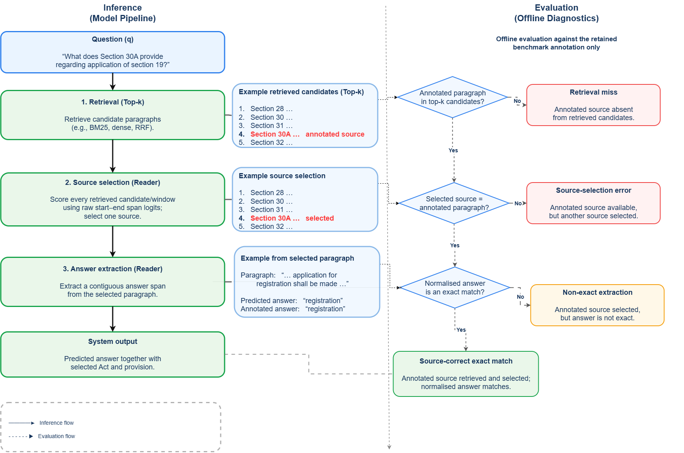
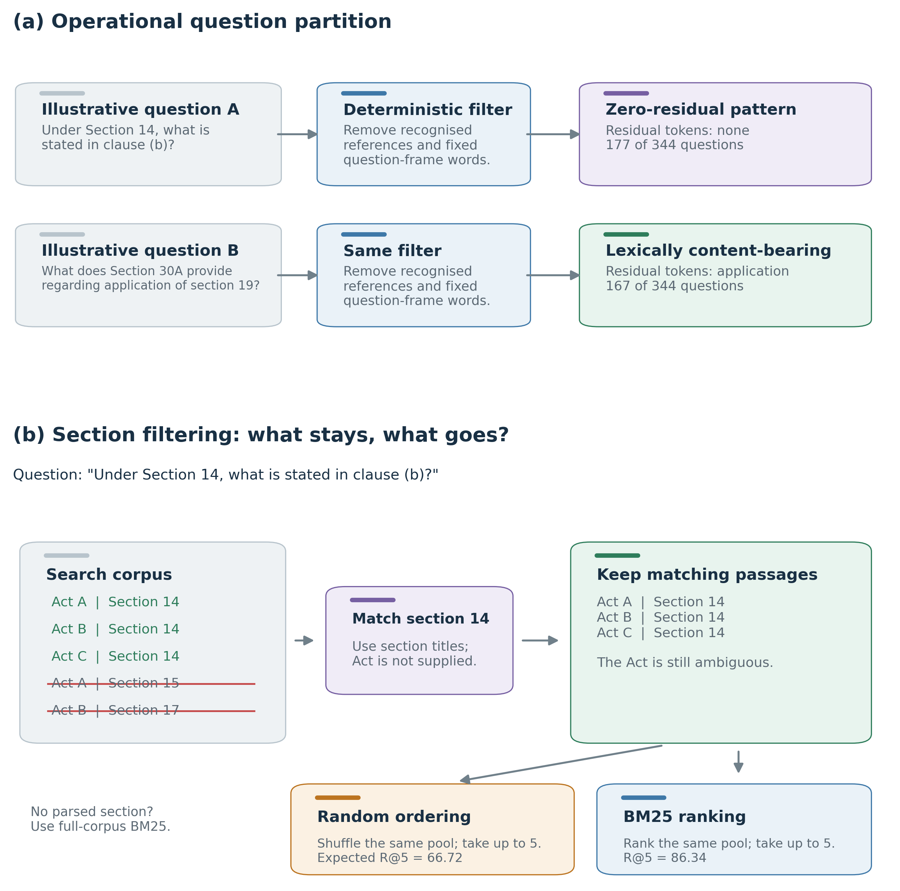
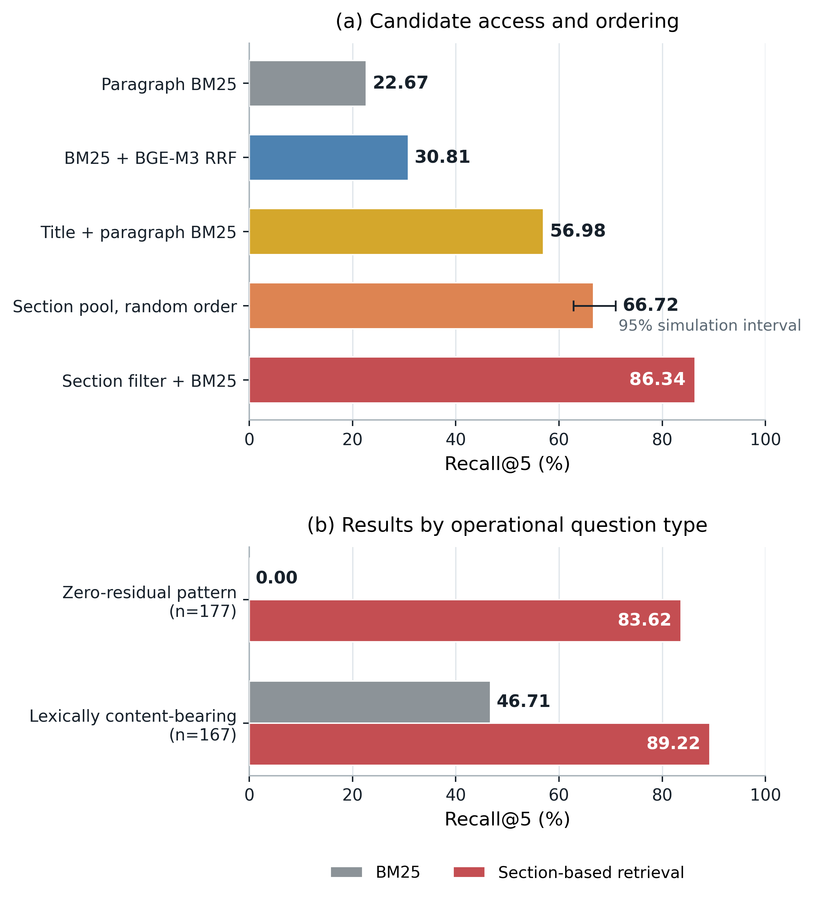
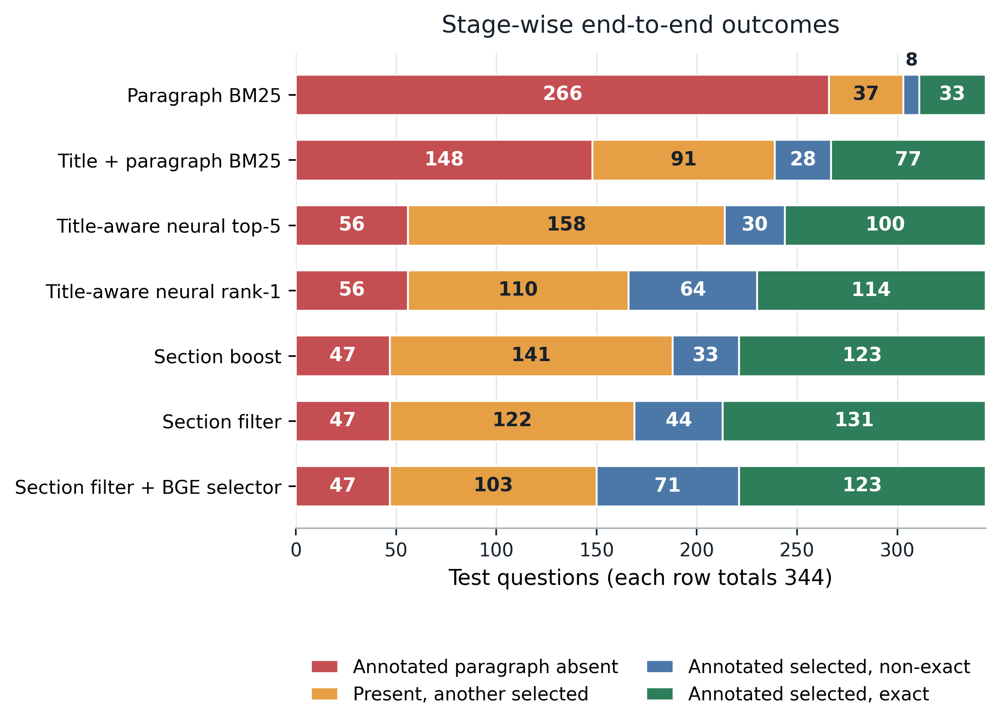
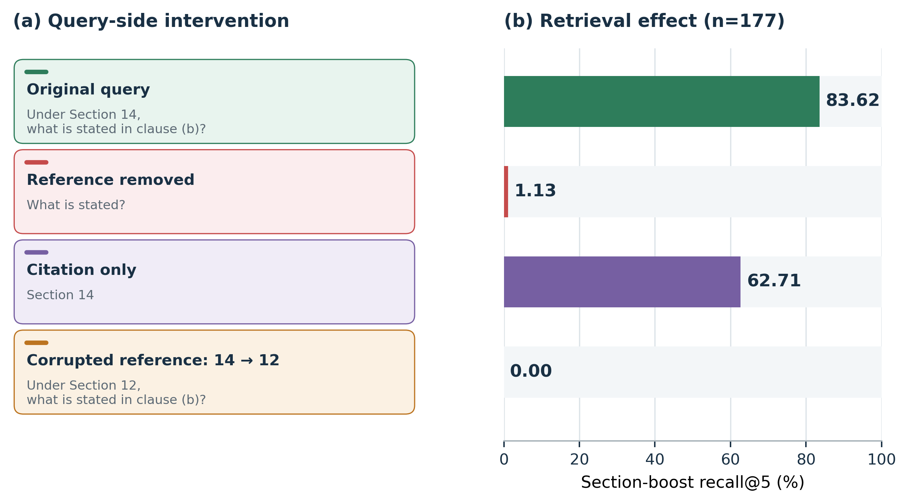

<div align="center">

# ⚖️ Retrieval and Source Selection in Statutory QA

### Beyond Answer Extraction: Diagnosing Retrieval and Source Selection Failures in Indian Statutory Question Answering

[](#quick-start)
[](#research-at-a-glance)
[](#dataset-and-scope)
[](#reproduce-the-complete-paper)
[](#repository-guide)
[](papers/retrieval_reference/retrieval-reference.pdf)
[](https://anonymous.4open.science/r/Retrieval-and-Source-Selection-Failures-in-Indian-Statutory-Question-Answering-9506/)

**Anonymous authors** · Double-anonymous review version

[Pipeline](#diagnostic-pipeline) · [Results](#research-at-a-glance) · [Visual summary](#visual-summary) · [Reproduce](#reproduce-the-complete-paper) · [Paper](papers/retrieval_reference/retrieval-reference.pdf) · [Citation](#citation)

</div>

---

## ✨ Why this repository matters

Strong answer extraction does not guarantee reliable statutory question
answering. A system may extract an answer well when it is given the annotated
paragraph, but fail to retrieve that paragraph or select it from several
plausible candidates.

> [!IMPORTANT]
> **Core idea:** a single QA score can hide three different problems: the
> annotated source was not retrieved, another source was selected, or the
> reader extracted a mismatched answer span.

This repository accompanies a diagnostic study of that gap in IndicIPR-QA,
an extractive question-answering benchmark over seven Indian intellectual
property statutes. It separates three annotation-relative pipeline stages:

```text
Question → candidate retrieval → source selection → answer extraction
                 ↓                    ↓                   ↓
          source absent        other source chosen    span mismatch
```

The study asks how a paragraph-only representation changes retrieval, whether
query-side statutory locators help recover the annotated source, and which
errors remain after source recovery improves. Section filtering is a controlled
diagnostic, not a proposed universal retrieval architecture.

## Diagnostic pipeline

The paper keeps the answer reader fixed and follows each question through
candidate retrieval, source selection, and answer extraction. Offline checks
then assign one of four annotation-relative outcomes: retrieval miss,
source-selection error, non-exact extraction, or source-correct exact match.

<p align="center">
  
</p>

<p align="center"><em>The model pipeline is shown on the left and the corresponding annotation-relative diagnostics on the right. These checks do not determine the legally controlling source.</em></p>

## 📊 Research at a glance

| Diagnostic result | Value |
|---|---:|
| Fixed reader F1 with annotated paragraph | **87.37** |
| Fixed reader F1 after paragraph-only BM25 top-5 | **31.95** |
| Paragraph-only BM25 recall@5 | **22.67%** |
| Title-plus-paragraph BM25 recall@5 | **56.98%** |
| Section-filter recall@5 | **86.34%** |
| Section-filter end-to-end F1 | **57.99** |
| Title-aware neural retrieval recall@5 | **83.72%** |
| Section filter versus title-aware BM25 F1 difference | **+12.92** points, 95% cluster interval **[6.62, 19.44]** |

> [!TIP]
> **Headline result:** paragraph-only BM25 recovers the annotated source in
> only **22.67%** of top-five candidate pools. Section-aware filtering raises
> this to **86.34%**, while the remaining errors expose Act ambiguity,
> source-selection errors, and answer-boundary errors.

The preserved experiments include sparse retrieval, zero-shot dense retrieval,
RRF, cross-encoder reranking, BGE-M3 retrieval, BGE reranking, title-aware
controls, random-pool controls, reference interventions, decoder sensitivity,
source-selection analyses, a human legal-adequacy audit, and a UK retrieval
comparison.

<p align="center">
  
</p>

<p align="center"><em>Operational overview of the retrieval diagnostic. See the paper for the complete protocol and limitations.</em></p>

## Visual summary

### Candidate access and question type

Section identifiers sharply reduce the candidate space in this
reference-heavy benchmark. Ranking the matched section pool with BM25 improves
recall beyond random ordering of the same pool.

<p align="center">
  
</p>

### Stage-wise outcomes

Improved retrieval does not eliminate later failures. Even when the annotated
paragraph is available, the active source selector may choose another passage;
after the annotated source is selected, the reader may still predict a
non-exact span.

<p align="center">
  
</p>

### Query-reference intervention

Removing, isolating, or replacing a section reference shows how statutory
locators guide retrieval. The corrupted-reference condition is a controlled
redirection stress test, not a model of ordinary user error.

<p align="center">
  
</p>

All figures report benchmark-annotation-relative measurements. The human audit
in the paper separately examines whether selected sources and answers are
legally adequate under the supplied material.

## 🗂️ Dataset and scope

| Item | Value |
|---|---:|
| Question-answer pairs | **4,462** |
| Paragraph-level statutory contexts | **1,116** |
| Statutes | **7 Indian IPR Acts** |
| Train / validation / test questions | **3,710 / 408 / 344** |
| Human legal-adequacy audit | **80 stratified cases** |

> [!NOTE]
> **Dataset:** the fixed corpus and train/validation/test splits needed for the
> paper are included under [`data/`](data/). Identifying public-hosting details
> are withheld during double-anonymous review.

The repository contains fixed corpus and split files for exact results-based
reproduction. The findings are benchmark-specific: they measure recovery of a
retained annotated source, not unique legal correctness or a universal limit on
legal retrieval. Questions are generated and curated, so their frequency of
explicit statutory locators may differ from naturally occurring legal requests.

## 🚀 Quick start

Run the commands from the repository root.

```powershell
# Download the anonymous review snapshot, extract it, and enter its root folder.
Set-Location Retrieval-and-Source-Selection-Failures-in-Indian-Statutory-Question-Answering
py -3.12 -m venv .venv
.\.venv\Scripts\Activate.ps1
python -m pip install --upgrade pip
pip install -r requirements.txt
```

On Linux or macOS, activate the environment with `source .venv/bin/activate`.

## 🔬 Reproduce the complete paper

The public release supports a complete **results-to-PDF reproduction** of the
paper: verify the saved item-level evidence, recompute the manuscript numbers,
regenerate the quantitative figures, and compile the LaTeX source. This path
does not download models or require a GPU.

It is different from a **from-scratch inference rerun**. The latter additionally
requires public model downloads and three inputs that are deliberately not
stored in this repository: the fixed LegalBERT reader checkpoint, the licensed
UK-StatuteCorpus archive, and the private human-review workbooks. The table and
instructions below make that boundary explicit.

| Reproduction target | Included in this release? | Extra input or compute |
|---|:---:|---|
| Recompute manuscript tables, counts, and intervals | Yes | None |
| Regenerate quantitative paper figures | Yes | None |
| Rebuild the manuscript PDF | Yes | A LaTeX distribution with `pdflatex` and `bibtex` |
| Rerun public dense retrievers and rerankers | Code only | Hugging Face downloads; GPU recommended |
| Rerun fixed-reader QA inference | Code and cached outputs | Original reader checkpoint for uncached pairs |
| Rerun the UK external comparison | Code and saved outputs | Separately obtained UK-StatuteCorpus archive |
| Recreate the human audit from original forms | Aggregate and de-identified labels only | Restricted source workbooks and decoding key |

### A. Complete public results-to-PDF workflow

Run these commands from the repository root after completing the
[Quick start](#quick-start).

#### 1. Verify the release and recompute the paper numbers

```powershell
python verify_release.py
python scripts/04_retrieval/audit_retrieval_manuscript.py
python scripts/04_retrieval/audit_retrieval_bibliography.py
```

The first command checks the expected files, test-set size, and headline
invariants. The manuscript audit recomputes retrieval metrics, reader scores,
stage counts, citation analyses, UK per-query means, and bootstrap intervals
from the released evidence. The bibliography audit checks cited identifiers
and bibliography consistency. These are artifact audits, not model reruns or
independent legal validation.

#### 2. Regenerate the analysis figures

```powershell
python scripts/08_figures/make_retrieval_paper_analysis_figures.py
```

This writes the generated PDF and PNG figures to
`papers/retrieval_reference/plots/` and asserts their headline inputs before
rendering. The manuscript's pipeline figure, `plots/pipeline1.png`, is a curated
source asset included in the release rather than a programmatically generated
chart. To regenerate the unused archived alternative diagram, run:

```powershell
python scripts/08_figures/make_retrieval_decoder_diagram.py
```

#### 3. Compile the manuscript

```powershell
Push-Location papers/retrieval_reference
pdflatex -interaction=nonstopmode -halt-on-error retrieval-reference.tex
bibtex retrieval-reference
pdflatex -interaction=nonstopmode -halt-on-error retrieval-reference.tex
pdflatex -interaction=nonstopmode -halt-on-error retrieval-reference.tex
Pop-Location
```

The rebuilt paper is
`papers/retrieval_reference/retrieval-reference.pdf`. The repeated LaTeX passes
resolve the bibliography, cross-references, and figure/table numbering. On
Linux or macOS, use `cd papers/retrieval_reference` in place of
`Push-Location` and return to the repository root afterward.

### B. From-scratch retrieval and inference reruns

The main experiment entry points are shown below. Run them from the repository
root; they write versioned reports under `results/experiments/retrieval/`.

```powershell
# Paragraph-only sparse, dense, fusion, and legacy reranking baselines
python scripts/04_retrieval/dense_retrieval_experiment.py
python scripts/04_retrieval/cross_encoder_rerank_experiment.py

# Question grouping, section retrieval, reference interventions, and controls
python scripts/04_retrieval/citation_specified_questions.py --write-artifacts
python scripts/04_retrieval/citation_aware_retrieval_experiment.py
python scripts/04_retrieval/citation_contribution_ablation.py
python scripts/04_retrieval/wrong_act_severity.py
python scripts/04_retrieval/retrieval_diagnostic_controls.py
python scripts/04_retrieval/retrieval_followup_controls.py
python scripts/04_retrieval/section_filter_act_extension.py

# BGE-M3, title-aware retrieval, and independent source selection
python scripts/04_retrieval/modern_retrieval_extension.py --prepare-models
python scripts/04_retrieval/modern_retrieval_extension.py --dataset indic --device auto
python scripts/04_retrieval/metadata_neural_and_selector_control.py --device auto
python scripts/04_retrieval/validate_metadata_neural_selector.py
```

The three end-to-end reader scripts below require the fixed QA checkpoint. It
is not redistributed; pass its local directory explicitly rather than relying
on the absent default path:

```powershell
python scripts/04_retrieval/citation_aware_retrieval_experiment.py --with-reader --qa-model "PATH_TO_FIXED_READER" --device auto
python scripts/04_retrieval/metadata_matched_end_to_end_control.py --qa-model "PATH_TO_FIXED_READER" --device auto
python scripts/04_retrieval/title_neural_end_to_end_control.py --qa-model "PATH_TO_FIXED_READER" --device auto
```

The decoder and span-length robustness analysis can then be repeated with:

```powershell
python scripts/04_retrieval/review_robustness_audit.py --with-reader
```

That command reuses the released, provenance-checked reader cache where
possible; if a required question-passage pair is absent, it expects the reader
at the default checkpoint path recorded by the script. These programs perform
inference only. Training the inherited fixed reader is outside this paper's
experiment pipeline.

For the external UK comparison, obtain `uk-statutecorpus_v1.0.zip` separately
and follow [`docs/RETRIEVAL_EXTERNAL_VALIDATION_PROTOCOL.md`](docs/RETRIEVAL_EXTERNAL_VALIDATION_PROTOCOL.md).
The expected command shape is:

```powershell
python scripts/04_retrieval/uk_statutecorpus_external_validation.py --archive "PATH_TO_uk-statutecorpus_v1.0.zip"
python scripts/04_retrieval/modern_retrieval_extension.py --dataset uk --device auto
```

The second command expects the external data prepared at the protocol's
documented local path. Model and data revisions, hashes, canonical outputs, and
claim-to-artifact mappings are recorded in
[`docs/RESULT_PROVENANCE.md`](docs/RESULT_PROVENANCE.md),
[`ARTIFACT_MANIFEST.md`](ARTIFACT_MANIFEST.md), and the run manifests under
`results/experiments/retrieval/runs/`.

### C. Human-audit reproducibility boundary

The public release contains the seeded sampling manifest, codebook, verified
aggregate summary, and de-identified categorical labels. These are sufficient
to inspect the reported sample composition and released labels. Exact
re-execution of `summarize_human_validation.py` requires the restricted master
workbook, free-text records, and private passage-order decoding key, so it is
not presented as a public from-scratch command. See
[Human legal-adequacy assessment](#human-legal-adequacy-assessment) for the
released and withheld artifacts.

## 🧭 Repository guide

```text
.
├── data/
│   ├── processed/indic_ipr_qa/    # Released paragraph corpus
│   └── splits/                    # Fixed train, validation, and test splits
├── docs/                          # Protocols, provenance, and audit notes
├── outputs/
│   └── human_validation_report/   # Verified aggregate and de-identified audit data
├── papers/retrieval_reference/    # LaTeX manuscript, bibliography, figures, PDF
├── results/experiments/retrieval/ # Canonical results and item-level evidence
├── scripts/
│   ├── 04_retrieval/              # Retrieval, reranking, and audit programs
│   ├── 08_figures/                # Figure generators
│   └── qa_evaluation.py            # Shared EM/F1 and span evaluation
├── requirements.txt                # Pinned Python environment
└── verify_release.py               # Fast integrity check
```

`docs/RESULT_PROVENANCE.md` maps the paper claims to the saved artifacts.
`ARTIFACT_MANIFEST.md` records the contents and exclusions of this release.

## ⚖️ Human legal-adequacy assessment

Two law graduate students independently assessed 80 stratified section-filter
cases. Original agreement, later consensus, and the annotation-relative
retrieval measures are kept separate.

Publicly available:

- `outputs/human_validation_report/manuscript_summary.json`: verified aggregate
  results, agreement coefficients, hashes, and calculation checks.
- `outputs/human_validation_report/anonymized_item_labels.jsonl`: de-identified
  original categorical ratings and consensus labels for reanalysis.
- `outputs/retrieval_legal_expert_audit/`: the public codebook and sampling
  manifest.

Not released: annotator-identifying workbooks, free-text rationales, authority
notes, dates, and the private passage-order decoding key.

## ✍️ Citation

Author names, affiliations, the permanent repository URL, and final citation
metadata are intentionally withheld in this double-anonymous review snapshot.
They will be restored in the de-anonymized archival release. During review,
refer to the accompanying submission as **Anonymous (2026)**, consistently
with the manuscript:

```bibtex
@unpublished{anonymous2026retrieval,
  author = {Anonymous},
  title = {Beyond Answer Extraction: Diagnosing Retrieval and Source Selection
           Failures in Indian Statutory Question Answering},
  year = {2026},
  note = {Manuscript under double-anonymous review}
}
```

The anonymous citation and withheld links should be replaced only in the
de-anonymized final version.

---

<div align="center">

**Statutory retrieval · Source selection · Extractive QA · Legal NLP**

</div>
